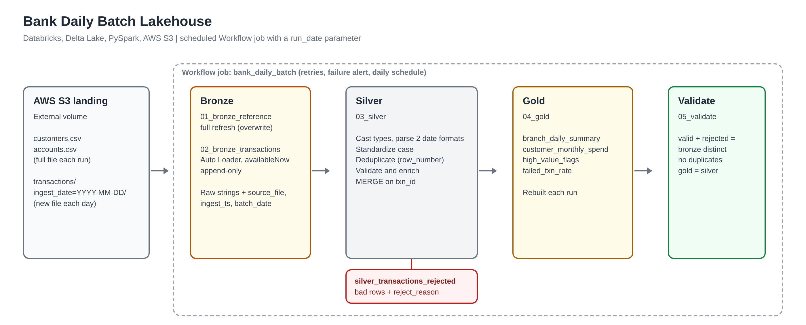
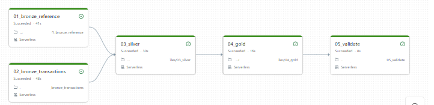

# Bank Daily Batch Lakehouse (Databricks, Delta Lake, PySpark)

An incremental batch pipeline that ingests daily bank transaction files from AWS S3, cleans and validates them, and produces reporting tables for branch managers and a fraud team. Built on Databricks with the medallion architecture and orchestrated by a Workflows job.

## Architecture
Dataflow Text
```
S3 landing folder (external volume)
   |-- customers.csv      (full file each run)
   |-- accounts.csv       (full file each run)
   `-- transactions/ingest_date=YYYY-MM-DD/*.csv   (new file each day)
        |
        v
BRONZE   raw data as strings + source_file, ingest_ts, batch_date
        |
        v
SILVER   typed, standardized, deduplicated, validated, enriched
        |             `--> silver_transactions_rejected (bad rows + reject_reason)
        v
GOLD     business reporting tables
        |
        v
VALIDATE reconciliation checks (job fails if counts do not match)
```

<!-- Replace this block with a diagram image, for example docs/architecture.png -->


## Design decisions

| Data | Load type | Why |
| --- | --- | --- |
| customers, accounts | Full refresh (overwrite) | Small reference data, reloaded in full each run |
| transactions | Incremental batch (Auto Loader, `availableNow`, append-only bronze) | Large, growing data; only new files are processed each run |

- **Bronze keeps raw strings** (`inferSchema` off) so no data is lost and the schema stays stable across days.
- **Silver** casts types, parses two date formats, standardizes case, removes repeated transactions (`row_number` over `txn_id`, latest `ingest_ts` wins), quarantines invalid rows, and `MERGE`s into the target on `txn_id`.
- **Idempotent reruns:** Auto Loader checkpoints track processed files, silver uses `MERGE`, gold is rebuilt from silver. Running the job twice gives the same result.
- **Data quality:** rows with a missing or non-positive amount, an invalid date, or an unknown account go to `silver_transactions_rejected` with a `reject_reason`.

## Tables

| Layer | Table | Description |
| --- | --- | --- |
| Bronze | `bronze_customers`, `bronze_accounts` | Raw reference data, overwritten each run |
| Bronze | `bronze_transactions` | Raw transactions, append-only, one row per row received |
| Silver | `silver_customers`, `silver_accounts` | Cleaned reference data |
| Silver | `silver_transactions` | Valid, deduplicated, enriched with branch, city, segment |
| Silver | `silver_transactions_rejected` | Invalid rows with the reason |
| Gold | `gold_branch_daily_summary` | Credits, debits and net flow by branch and day |
| Gold | `gold_customer_monthly_spend` | Monthly debit spend per customer, ranked within segment |
| Gold | `gold_high_value_flags` | Successful debits above 50,000 for the fraud team |
| Gold | `gold_failed_txn_rate` | Failed transaction percentage by branch |

## Workflow job



`bank_daily_batch` has five tasks:

1. `01_bronze_reference`
2. `02_bronze_transactions` (runs in parallel with task 1)
3. `03_silver` (depends on 1 and 2)
4. `04_gold`
5. `05_validate`

Job parameter `run_date` = `{{job.start_time.iso_date}}`. Retries are set on each task, with an email alert on failure and a daily schedule.

## Validation

`05_validate` fails the job if any of these is false:
- valid + rejected = distinct transactions in bronze
- no duplicate `txn_id` in silver
- gold totals match silver

## Results (sample data)

| Check | Result |
| --- | --- |
| Bronze transactions after 3 daily files | 176 rows (170 distinct) |
| Silver valid / rejected | 86 / 84 |
| Duplicates in silver | 0 |
| Rerun with no new file | Counts unchanged |

## Repository layout

```
bank-batch-lakehouse/
  README.md
  data_generator/gen_bank_data.py
  notebooks/
    01_bronze_reference.py
    02_bronze_transactions.py
    03_silver.py
    04_gold.py
    05_validate.py
  docs/
    architecture_final.png
    jobs_run_graph.png
```

## How to run

1. Generate the sample data with `data_generator/gen_bank_data.py`, or use your own files.
2. Upload it to an S3 location registered as a Unity Catalog external volume (`landing/customers`, `landing/accounts`, `landing/transactions/ingest_date=...`).
3. Import the notebooks into a Databricks workspace.
4. Create a job with the five tasks above, set the `run_date` and `catalog` job parameters, and run it.

## Skills demonstrated

PySpark, Spark SQL, Delta Lake (`MERGE`, schema handling), Auto Loader, Unity Catalog external volumes, Databricks Workflows, AWS S3, data quality and reconciliation, idempotent pipeline design.
